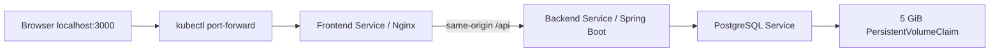

# FreshMart on Minikube (Task 13)

This is a local Windows/Docker Desktop deployment. It reuses the Task 11 images
and all existing application code. It does not deploy Terraform, AWS, EKS or Helm.
Work only on the `devops` Git branch. Scripts do not commit, push or merge.

## Prerequisites and deployment

Use Docker Desktop in Linux container mode, Minikube, kubectl, Windows PowerShell
and Python 3 (for integration tests). Allocate enough Docker Desktop resources for
the 4 CPU / 4 GiB Minikube node plus image builds. Start Docker Desktop first.

Run from the repository root in PowerShell:

```powershell
if ((git branch --show-current) -ne 'devops') { throw 'Stop: work only on devops.' }
docker info
minikube version
kubectl version --client

# First run only; refuses to overwrite existing credentials.
.\devops\kubernetes\Initialize-Secrets.ps1

# Builds the existing Dockerfiles, starts profile freshmart, loads images,
# creates a local Secret, deploys everything and provisions initial accounts.
.\devops\kubernetes\Deploy-Minikube.ps1 -BootstrapUsers
```

The build includes the existing frontend tests/build and Maven verification.
Docker may reuse those layers if source inputs have not changed. To reuse images
already tagged `freshmart-backend:task13` and `freshmart-frontend:task13`, add
`-SkipBuild`. Re-running deployment without `-BootstrapUsers` preserves accounts
and the database. Bootstrap uses the existing password-hashing/seeding logic;
the script disables it after provisioning, including when its rollout fails.

In a **second PowerShell terminal**, from the repository root:

```powershell
.\devops\kubernetes\Open-FreshMart.ps1
```

Browse **http://localhost:3000**. Keep that terminal open. It forwards only on
127.0.0.1 and reconnects when its selected frontend Pod is replaced. This avoids
Windows Docker-driver node-IP routing issues. If port 3000 is occupied, stop the
other local listener first. Use `localhost`, matching the configured origin.

Initial logins are `admin@freshmart.com` and `cashier@freshmart.com`. Read their
generated passwords privately from `devops/kubernetes/.local/.env` (for example
open it in Notepad). Select the matching workspace on the login page. Never copy
the file into an issue, screenshot, chat or commit. Keep this file for subsequent
deployments; the script refuses to replace a different existing cluster Secret.

## Files and architecture

| File | Purpose |
| --- | --- |
| `kustomization.yaml` | Applies resources and generates a content-hashed Nginx ConfigMap |
| `namespace.yaml` | Dedicated `freshmart` namespace with restricted Pod security |
| `configmap.yaml` | Non-secret database, origin, timezone and application configuration |
| `services.yaml` | Internal ClusterIP Services for frontend, backend and PostgreSQL |
| `frontend-deployment.yaml` | React/Nginx, probes, limits and rolling updates |
| `nginx.conf` | Kubernetes Service proxy for `/api`, SPA fallback and security headers |
| `backend-deployment.yaml` | Java 17 API, database wait, probes and rolling updates |
| `postgres-deployment.yaml` | PostgreSQL 17, single-replica Recreate deployment and 5 GiB PVC |
| `.env.example` | Empty secret fields and safe local testing metadata |
| `Initialize-Secrets.ps1` | Cryptographic credentials in ignored `.local/.env`, Windows ACL restriction |
| `Deploy-Minikube.ps1` | Branch guard, start/build/load, Secret provisioning, bootstrap and rollout |
| `Open-FreshMart.ps1` | Reconnecting local browser port-forward |
| `test-minikube.py` | Guarded API, persistence, scaling and resilience tests |



Nginx resolves `backend` through Kubernetes DNS to its stable Service IP. Backend
Pod replacement/scaling does not require changing Nginx. The container waits for
CoreDNS resolution before starting Nginx, including after cluster restarts. If you delete/recreate
the **Service** and its IP changes, restart the frontend deployment. The existing
Docker Compose Nginx configuration is unchanged. Kustomize hashes Nginx config
changes into a new ConfigMap name, automatically updating the Pod template.

JWT and CSRF use the existing cookies and `/api` proxy on the same browser origin.
All backend replicas share the same JWT secret and database; no sticky sessions
are required. `AUTH_COOKIE_SECURE=false` is only for local HTTP. Never expose this
local setup publicly as a production TLS deployment.

Secrets are created from stdin, without passwords in command arguments or saved
YAML. Secret values are not placed in frontend configuration. Kubernetes Secrets
are base64-encoded storage, not a guarantee of encryption: protect Docker Desktop,
your kubeconfig and local account. The local PostgreSQL provisioning user remains
the same kind of local DB owner used by Compose; production database credentials
and encrypted secret delivery are outside this Minikube task.

All Pods run as non-root with read-only root filesystems, dropped capabilities,
runtime-default seccomp and no service-account token mount. Writable temporary
paths use bounded `emptyDir` volumes. There is no hostPort/hostNetwork, public
database port, privileged container or cloud load balancer. ClusterIP isolation
does not implement network policies; do not add untrusted workloads to this local
cluster. Resource limits apply to every application and init container.

PostgreSQL startup/readiness/liveness use `pg_isready`. The backend waits for the
database before Flyway startup and probes the existing `/api/auth/csrf` endpoint;
this checks HTTP availability, **not ongoing database health**. No application
health endpoints or business code were changed. Frontend probes check `/health`.

## Inspection and repeatable testing

Keep the forwarding terminal running. In another terminal:

```powershell
kubectl --context=freshmart apply --dry-run=server -k devops/kubernetes
kubectl --context=freshmart -n freshmart get deployments,pods,services,pvc
kubectl --context=freshmart -n freshmart get endpointslices
kubectl --context=freshmart -n freshmart logs deployment/backend --tail=40

python devops/kubernetes/test-minikube.py
```

The test refuses other node/database names, checks the real database identity,
and uses the existing guarded Docker API smoke test. It creates new test products
and two sales on every run. It checks both roles, HttpOnly JWT cookies, rejected
anonymous/missing-CSRF/admin-only requests, Cash/Card totals, idempotent checkout
and stock 10 -> 6. It scales frontend/backend to two, deletes individual Pods,
verifies new identities and persistent sales/inventory/PVC, monitors an existing
authenticated session through a backend rolling restart, and tests frontend
restart/reconnection. It restores application replicas to one in `finally`.

The test mutates **only** `freshmart_kubernetes_test` in profile `freshmart`.
It does not use native PostgreSQL or Docker Compose volumes. The replica/pod
operations are intentional test disruptions; don't run them during checkout.

Manual equivalents (never scale PostgreSQL above one):

```powershell
kubectl --context=freshmart -n freshmart scale deployment/backend deployment/frontend --replicas=2
kubectl --context=freshmart -n freshmart rollout status deployment/backend --timeout=600s
kubectl --context=freshmart -n freshmart get pods

# Delete one selected backend Pod and observe its replacement.
$pod = kubectl --context=freshmart -n freshmart get pods -l app=backend -o jsonpath='{.items[0].metadata.name}'
kubectl --context=freshmart -n freshmart delete pod $pod
kubectl --context=freshmart -n freshmart rollout status deployment/backend --timeout=600s

kubectl --context=freshmart -n freshmart rollout restart deployment/backend deployment/frontend
kubectl --context=freshmart -n freshmart rollout status deployment/backend --timeout=600s
kubectl --context=freshmart -n freshmart rollout status deployment/frontend --timeout=600s
kubectl --context=freshmart -n freshmart scale deployment/backend deployment/frontend --replicas=1
```

For an actual application image update, use a new tag instead of overwriting an
old one, load it with `minikube -p freshmart image load <image:tag>`, update the
appropriate manifest image and apply `kubectl --context=freshmart apply -k
devops/kubernetes`. Deployments use `maxUnavailable: 0`, `maxSurge: 1` and readiness
gates. `kubectl rollout undo deployment/backend` (with the same context/namespace)
can restore a prior image revision, provided its image is still available. Image
rollback does not undo database migrations. Commit the intended manifest change
separately; scripts do not commit it for you.

The backend uses graceful Spring shutdown. Nginx delays termination and quits
gracefully. A frontend port-forward is tied to one Pod, so it may briefly disconnect
during frontend replacement even though another frontend is ready. The helper
reconnects; refresh the browser if needed. This local access path is not an ingress
high-availability guarantee. Scaling is manual; no HPA or cluster autoscaler is
installed. A single-node cluster and single PostgreSQL instance are not HA.

## Persistence and stopping

The default Minikube `standard` storage class dynamically provisions node-local
storage. PostgreSQL Pod replacement and `minikube stop/start` retain the PVC/data.
This is not a backup or protection against deleting the cluster, PVC or namespace.
Do not delete them to stop the app. Keep credentials matched to the existing PVC:
changing `POSTGRES_PASSWORD` after initialization does not rotate database users.

```powershell
# Stop without removing the database (stop forwarding with Ctrl+C first).
minikube stop -p freshmart

# Resume without rebuilding or provisioning accounts again.
minikube start -p freshmart --driver=docker --cpus=4 --memory=4096 --kubernetes-version=v1.36.1
kubectl --context=freshmart -n freshmart rollout status deployment/postgres --timeout=300s
kubectl --context=freshmart -n freshmart rollout status deployment/backend --timeout=600s
kubectl --context=freshmart -n freshmart wait --for=condition=Ready pod --all --timeout=600s
.\devops\kubernetes\Open-FreshMart.ps1
```

## Troubleshooting

- `ImagePullBackOff`: build/tag and load both application images into profile
  `freshmart`; manifests intentionally use `IfNotPresent`.
- `Pending`: inspect `kubectl describe pod` and `get pvc`; enable Minikube's
  `storage-provisioner`/`default-storageclass` addons and check available resources.
- `CrashLoopBackOff`: inspect application logs and previous logs. Check matching
  local/cluster credentials, database availability and Flyway messages. Do not
  dump Secrets or full environment output into logs.
- Login fails: use the matching workspace and bootstrap once. Existing accounts
  are never reset. Confirm `localhost:3000`, cookies enabled and the forward running.
- Port-forward errors during Pod changes: the helper reconnects. Persistent bind
  errors mean another process already owns local port 3000.
- A script interrupted during bootstrap may leave its override in place: remove
  it with `kubectl --context=freshmart -n freshmart set env deployment/backend
  BOOTSTRAP_USERS_ENABLED-` and wait for the rollout before scaling.

See [TEST-RESULTS.md](TEST-RESULTS.md) for observed results and limitations.

References: [Minikube Windows access](https://minikube.sigs.k8s.io/docs/handbook/accessing/),
[loading images](https://minikube.sigs.k8s.io/docs/handbook/pushing/),
[Kubernetes rolling updates](https://kubernetes.io/docs/concepts/workloads/controllers/deployment/),
and [startup/readiness/liveness probes](https://kubernetes.io/docs/concepts/workloads/pods/probes/).
