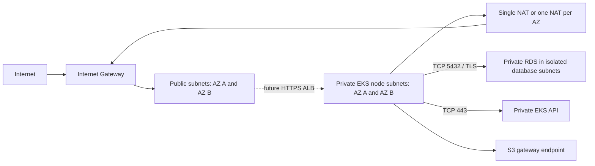

# Task 12: Terraform and AWS infrastructure

This configuration defines FreshMart infrastructure only. It has been formatted,
initialized without a backend, validated and tested with a mocked AWS provider.
**No AWS infrastructure has been provisioned and no `terraform apply` has been run.**
All work for Tasks 12-17 belongs on `devops`; do not switch to or modify `main`.

## Folder structure

```text
devops/terraform/
  versions.tf                 Terraform/provider constraints
  providers.tf                Region, account guard and shared tags
  variables.tf                Validated environment/cost/security inputs
  main.tf                     Module composition and node-to-database access
  outputs.tf                  Connection details, subnet IDs and role references
  .terraform.lock.hcl          Verified AWS provider version and checksums
  terraform.tfvars.example    Safe configuration examples; no credentials
  backend.tf.example          Optional S3 backend declaration
  state.backend.hcl.example   Optional existing-bucket configuration
  modules/
    network/                  VPC, subnet tiers, routes, NAT and S3 endpoint
    eks/                      Cluster, workers, platform add-ons, SGs and IAM
    database/                 Private RDS PostgreSQL and its supporting resources
  tests/
    *.tftest.hcl              Plan-only tests with mocked AWS resources
    mocks/aws.tfmock.hcl      Synthetic provider responses
```

Each module declares its provider requirement and exposes its outputs. Provider
configuration and default tags are inherited from the root. There are no external
Terraform module downloads and no Kubernetes or Helm providers.

## Resource inventory

| Area | Resources configured |
| --- | --- |
| Network | One DNS-enabled VPC; two public `/24`, two private node `/20`, and two isolated database `/24` subnets across two AZs |
| Routing | Internet Gateway; one public, two node and one isolated database route table; six subnet associations; public internet route and two private NAT routes |
| Egress | One NAT Gateway/EIP by default, or two in `per_az` mode; S3 gateway endpoint attached to node route tables |
| Network security | Empty VPC default SG; dedicated control-plane, worker, future-ALB and database SGs with explicit rules |
| EKS | One standard managed control plane; configurable managed node groups (one by default, desired two nodes); one EC2 launch template per group |
| IAM/access | Separate cluster, worker and VPC CNI roles; four AWS-managed policy attachments; OIDC identity provider; an EKS access entry and cluster-scoped access-policy association for each approved existing admin role |
| EKS platform | Managed VPC CNI, kube-proxy and CoreDNS add-ons; a 30-day control-plane CloudWatch log group |
| Database | Private PostgreSQL 17 DB instance; two-AZ DB subnet group; TLS parameter group; a 30-day PostgreSQL CloudWatch log group |
| AWS-managed resources | RDS-managed Secrets Manager master credential and encryption keys; EKS primary SG/control-plane ENIs; managed-node EC2 instances, EBS disks and Auto Scaling group; service-linked roles as required by AWS |

No ALB, listener, ACM certificate, public DNS record, controller Helm chart,
application Deployment/Service/Ingress, application secret or database login is
created. EKS networking/DNS add-ons are cluster prerequisites, not Task 13
application deployment. Existing Docker, GitHub Actions and application files
are unchanged.

## Network and access design

Default region is **Mumbai (`ap-south-1`)**, with example AZs `a` and `b` and VPC
`10.42.0.0/16`. Confirm AZ availability in the intended account and choose a VPC
CIDR that does not overlap connected networks. Change AZs when changing region.
Derived ranges are `10.42.0.0/24`, `10.42.1.0/24` (public), `10.42.16.0/20`,
`10.42.32.0/20` (workers), and `10.42.240.0/24`, `10.42.241.0/24` (database).



- Subnets do not auto-assign public IPs. The Internet Gateway route makes the
  public tier eligible for a future internet-facing ALB and NAT gateways.
- The database tier has only the VPC-local route. RDS has `publicly_accessible=false`
  and accepts TCP 5432 only from the EKS worker security group. It cannot be
  reached directly from a laptop/public internet. No unsolicited DB egress is
  allowed; security groups allow replies statefully.
- Workers accept cluster mesh traffic from their own SG, required control-plane
  ports, and port 8080 from the prepared ALB SG. There is no SSH rule or key pair.
  Node HTTPS egress permits AWS APIs, STS and image registries; DNS and PostgreSQL
  rules are separate. Namespace/pod-level restrictions are deployment work.
- EKS itself also creates its primary SG with AWS-managed default rules. This
  stack adds a separate control-plane group; it does not claim to remove EKS's
  primary-group default egress. Explicit launch-template SGs keep that primary
  group off the workers. See [EKS security groups](https://docs.aws.amazon.com/eks/latest/userguide/sec-group-reqs.html).
- The Kubernetes API is private by default. Future operators need a network path
  into the VPC (such as an existing connected VPN or private runner) **and** an
  approved source in `eks_private_access_cidrs`. This task creates neither a VPN
  nor a runner. Standard GitHub-hosted runners cannot reach this private API.
- Alternatively, enable `eks_public_access` and supply explicit administrator
  `/32` or trusted network CIDRs. World-open public API access is rejected. IAM
  authentication is still required, and private endpoint access stays enabled.
- Public and worker subnets have the ALB discovery tags. Database subnets do not.
  The prepared ALB SG has no inbound access by default; configure approved HTTPS
  clients with `alb_ingress_cidrs` later. Its only target egress is frontend port
  8080, suitable for IP targets. NodePort/HTTP redirect access is not configured.
  See [AWS ALB prerequisites](https://docs.aws.amazon.com/eks/latest/userguide/alb-ingress.html).

## IAM and secrets

Supply your intended account ID and one or more existing IAM admin **role** ARNs.
The provider rejects credentials for another account. The cluster creator is not
automatically granted permanent administration. Only the specified roles receive
the EKS cluster-scoped admin access policy; no AWS `AdministratorAccess` policy
is created or attached by this stack.

Worker IAM uses AWS's node policy and ECR pull-only policy. VPC CNI permissions
are attached to a separate IRSA role trusted only by `kube-system/aws-node` in
this cluster. Workers receive no Secrets Manager, RDS management or general
application permissions. IMDSv2 with hop limit 1 limits ordinary pods' access to
node metadata; host-network workloads remain part of the node trust boundary.
EBS root volumes are encrypted. See [AWS node IAM guidance](https://docs.aws.amazon.com/eks/latest/userguide/create-node-role.html).

RDS uses `manage_master_user_password=true`: AWS generates and rotates its master
credential in Secrets Manager. There is no password input or secret-value data
source, and outputs contain only the secret **ARN**. Use a separately authorized
operator to provision a least-privilege application/migration login before
deployment. Do not run the application with the master account. See
[RDS password management](https://docs.aws.amazon.com/AmazonRDS/latest/UserGuide/rds-secrets-manager.html).

The database name remains `freshmart_pos`. SSL is required. Future deployment
must configure the backend's datasource and RDS CA trust with hostname
verification (for example `sslmode=verify-full`), plus application credentials.
Task 12 does not change application code, connect Flyway to RDS, or migrate
existing local data. The Docker-specific Nginx resolver also needs a Kubernetes
configuration in the later deployment task; the working Docker image is intact.

## Local validation without AWS credentials

Install Terraform **1.11 or newer, below 2.0**. Commands below start at the
repository root. Initialization downloads the provider, but makes no AWS
infrastructure API calls. No AWS credentials are needed for these checks.

```powershell
if ((git branch --show-current) -ne 'devops') { throw 'Stop: work only on devops.' }
Set-Location devops/terraform
terraform fmt -recursive
terraform init -backend=false -input=false
terraform validate
terraform test
terraform fmt -check -recursive
```

All test runs explicitly use `command = plan` and a mock AWS provider. Tests
cover both NAT layouts, isolated database routing, subnet discovery, EKS access,
worker/CNI IAM separation, encryption/IMDS, private RDS, TLS/backups, Multi-AZ,
module wiring and rejection of unsafe or inconsistent inputs.

## Generate a real plan (instructions only)

1. Stay on `devops`. Copy the example to ignored `terraform.tfvars`. Replace the
   example account ID/admin role; review region, AZs, network ranges, capacity,
   NAT mode and RDS availability. The example role and documentation-only IP
   address do not grant real access.
2. Authenticate through an existing AWS SSO profile or assumed role. Keep keys,
   tokens, passwords and secrets out of files and terminal history. A plan uses
   AWS read APIs and requires valid credentials; it does not provision resources.
3. Review the target identity, available AZs and supported versions, then plan:

```powershell
# From devops/terraform, after verifying the branch:
if (!(Test-Path terraform.tfvars)) { Copy-Item terraform.tfvars.example terraform.tfvars }
# Edit terraform.tfvars before continuing; the command preserves an existing file.
$env:AWS_PROFILE = 'your-existing-sso-profile'
aws sso login --profile $env:AWS_PROFILE
aws sts get-caller-identity
aws ec2 describe-availability-zones --region ap-south-1 --filters Name=state,Values=available
aws eks describe-cluster-versions --region ap-south-1
aws rds describe-db-engine-versions --region ap-south-1 --engine postgres --query "DBEngineVersions[?starts_with(EngineVersion, '17.')].EngineVersion"
terraform init
terraform plan -input=false -var-file=terraform.tfvars -out=freshmart.tfplan
terraform show freshmart.tfplan
```

The root defaults to local state for offline work. Before a shared deployment,
use an approved remote backend as described below. Saved plans/state may contain
sensitive infrastructure details even though RDS password values are not read.
Do not upload them to Git or public CI artifacts. There is deliberately no apply
or deployment command in this task.

The provisioning role must have the required EC2/VPC, EKS, RDS, CloudWatch and IAM
resource-management permissions, RDS-managed-secret permissions, and narrowly
scoped `iam:PassRole` for the three created service roles. First use of a service
can also require its service-linked role creation. Have the account administrator
scope these permissions to the intended account, region and resource prefix;
this stack does not grant provisioning privileges to itself.

EKS defaults to 1.36, which is currently in standard support. Add-on versions are
resolved against the selected Kubernetes version during a real plan. Review those
changes and regional availability. The `STANDARD` support policy avoids opting
into paid EKS extended support but permits AWS automatic upgrades when standard
support ends. Schedule cluster and node upgrades explicitly. PostgreSQL stays on
major version 17 with minor updates enabled and paid extended support disabled.
See [EKS version lifecycle](https://docs.aws.amazon.com/eks/latest/userguide/kubernetes-versions.html).

## Optional remote state

`backend.tf.example` is not loaded automatically. For an **existing** private S3
state bucket, copy it to `backend.tf`, copy `state.backend.hcl.example` to
`state.backend.hcl`, and replace the bucket, region and state key. Then initialize
with `terraform init -backend-config=state.backend.hcl`. If local state already
contains managed resources, arrange a reviewed state migration first.

The bucket must have public access blocked, versioning and encryption enabled,
and least-privilege access to the selected state key and `.tflock` object. The
example enables encryption and native S3 state locking. Use an approved existing
KMS key if required by your organization; grant the runner the needed key access.
No state bucket or KMS key is created by this task. Backend credentials must use
the AWS credential chain, never `-backend-config` secret arguments. See
[Terraform S3 backend guidance](https://developer.hashicorp.com/terraform/language/backend/s3).

`.gitignore` excludes `.terraform/`, state/backup/lock-info files, plans,
`*.tfvars`, `*.tfvars.json`, local backend configuration and override files. The
provider lock file and safe example files are intentionally versioned.

## Cost considerations

No billable resources were created for validation. Applying this configuration
later would incur ongoing costs even with no application traffic. The defaults
are a development starting point, not an availability or capacity guarantee.

Illustrative monthly arithmetic uses **730 hours** and public pricing checked
on 2026-10-28. Rates vary by region and can change:

| Cost | Estimate or sizing input |
| --- | --- |
| EKS standard control plane | $0.10/hour, about **$73/month**, excluding workers; extended support is $0.60/hour, about $438/month ([EKS pricing](https://aws.amazon.com/eks/pricing/)) |
| Single NAT | AWS's Ohio example is $0.045/hour, about **$32.85/month**, plus data processing and public IPv4; this is **not a Mumbai quote** |
| Per-AZ NAT | Two gateways double the fixed NAT/EIP count; they avoid using the other AZ's NAT during an outage |
| Public IPv4 | $0.005/hour per NAT EIP, about **$3.65/month each**; future public load balancers also consume public addresses ([VPC pricing](https://aws.amazon.com/vpc/pricing/)) |
| EC2 workers | Default two `t3.medium` nodes: `2 × 730 × regional hourly price`; also account for burst CPU credits where applicable |
| Worker disks | Default two 20-GiB gp3 encrypted volumes; multiply 40 GiB by regional storage pricing |
| RDS | One `db.t4g.micro` plus 20-GiB gp3 storage, growing up to 100 GiB; Multi-AZ adds paid standby capacity, and burst/storage/backup charges can apply |
| Secrets/logs/traffic | RDS-managed Secrets Manager storage/API calls, CloudWatch ingestion and 30-day retention, snapshots, internet/cross-AZ transfer and NAT processing |
| Future deployment | ALB hourly/LCU charges, DNS and any additional endpoints/controllers/storage are not included or created here |

At the **Ohio example NAT rate**, EKS + one NAT + its IPv4 address alone would be
about **$109.50/month**, before any EC2, RDS, storage, logs or traffic. Reprice the
entire stack for Mumbai using the [AWS Pricing Calculator](https://calculator.aws/).
Single NAT lowers fixed charges but introduces cross-AZ traffic charges and an
AZ dependency. The S3 gateway endpoint has no hourly charge and avoids NAT
processing for its traffic; see [VPC pricing](https://aws.amazon.com/vpc/pricing/).

For availability, consider `per_az` NAT, RDS Multi-AZ, sufficient node minimums
and application replicas. A managed group across two AZs does not guarantee one
node per AZ at every moment. Spot nodes are optional and interruptible. Scaling
limits do not install an autoscaler; Terraform controls the desired node count.

RDS deletion protection, seven-day backups and final snapshots are enabled.
Backup and maintenance window values in the database module are UTC.
Deleting infrastructure later requires an explicit decommission review; retained
snapshots still cost money. The final snapshot identifier must be unique: change
the override before deletion if a snapshot with the default name already exists.

## Validation results and remaining work

Validated on Windows with Terraform **1.15.8**, AWS provider **6.70.0**:

- `terraform fmt -recursive` and `terraform fmt -check -recursive`: pass.
- `terraform init -backend=false -input=false`: pass; signed provider checksums
  recorded in `.terraform.lock.hcl`.
- `terraform validate`: pass.
- `terraform test`: **13 passed, 0 failed**, all mocked, plan-only runs.

No live AWS plan was generated: account-specific credentials, IAM role ARNs,
quotas, AZ capacity, version availability and the chosen operating budget still
need confirmation by the account owner. Mocked tests verify configuration and
guardrails, not whether AWS will accept or successfully provision the stack.
No paid resources, remote state bucket, Kubernetes workloads or Task 13 deployment
were created. Task 12's configuration and requested local validation are complete
on `devops`.

## Changed files

Outside this directory: `.gitignore`, `README.md`,
`devops/aws/deployment-notes.md`.

Inside `devops/terraform/`:

- `README.md`, `versions.tf`, `providers.tf`, `variables.tf`, `main.tf`, `outputs.tf`
- `.terraform.lock.hcl`, `terraform.tfvars.example`, `backend.tf.example`, `state.backend.hcl.example`
- `modules/network/main.tf`, `modules/network/variables.tf`, `modules/network/outputs.tf`, `modules/network/versions.tf`
- `modules/eks/main.tf`, `modules/eks/security.tf`, `modules/eks/variables.tf`, `modules/eks/outputs.tf`, `modules/eks/versions.tf`
- `modules/database/main.tf`, `modules/database/variables.tf`, `modules/database/outputs.tf`, `modules/database/versions.tf`
- `tests/network.tftest.hcl`, `tests/eks.tftest.hcl`, `tests/database.tftest.hcl`, `tests/validation.tftest.hcl`, `tests/mocks/aws.tfmock.hcl`
